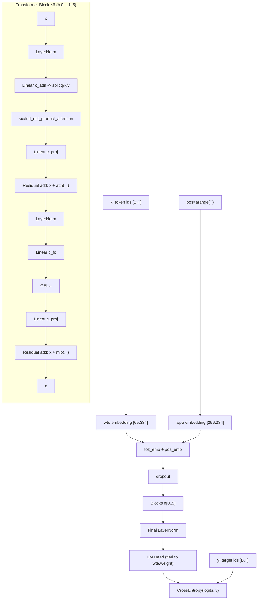
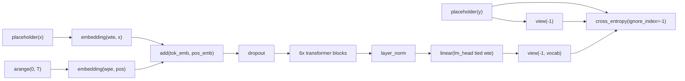
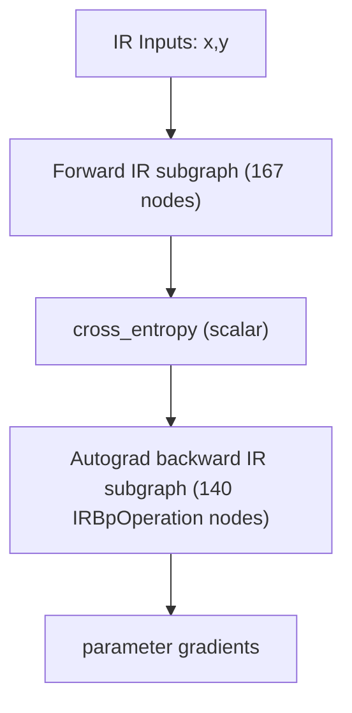

# nanoGPT Model Architecture, FX Graph, and IR Graph (4-GPU Runtime)

This document summarizes the current run artifacts under:

`examples/nanogpt/.nnscaler/_parallel_modules/__main__/LitModel/_`

## 1) nanoGPT model architecture (draw + list)

### 1.1 Run configuration (from `train_shakespeare_char.py`)

| Field | Value |
|---|---|
| `n_layer` | 6 |
| `n_head` | 6 |
| `n_embd` | 384 |
| `block_size` | 256 |
| `dropout` | 0.2 |
| `batch_size` | 64 |
| vocab size | 65 |

### 1.2 Architecture graph



### 1.3 Parameter/module listing (from generated metadata)

- `origin_param_names`: **39**
- `origin_state_dict_names`: **40**
- shared parameter group:
  - `model.transformer.wte.weight`
  - `model.lm_head.weight`
- total mapped parameter elements (from `gencode0.py` full maps): **10,745,088**

Main parameter groups:

1. `model.transformer.wte.weight`
2. `model.transformer.wpe.weight`
3. per block `h.0 ... h.5`:
   - `ln_1.weight`
   - `attn.c_attn.weight`
   - `attn.c_proj.weight`
   - `ln_2.weight`
   - `mlp.c_fc.weight`
   - `mlp.c_proj.weight`
4. `model.transformer.ln_f.weight`

---

## 2) FX graph

> Note: raw FX `GraphModule` text is not persisted by default in this run directory.  
> The graph below is reconstructed from the nnScaler conversion path and IR forward op trace.

### 2.1 FX conversion path

`train_nnscaler.py`  
→ `NnScalerStrategy._setup_model`  
→ `nnscaler.parallelize`  
→ `_gen_graph`  
→ `to_fx_graph` (`nnscaler/graph/parser/converter.py`)

### 2.2 FX forward graph (reconstructed)



### 2.3 Per-block FX op template (repeated 6 times)

```text
layer_norm
-> linear(c_attn)
-> split(q,k,v)
-> view/transpose (q,k,v shaping)
-> scaled_dot_product_attention
-> transpose/contiguous/view
-> linear(c_proj)
-> dropout
-> residual add
-> layer_norm
-> linear(c_fc)
-> gelu
-> linear(c_proj)
-> dropout
-> residual add
```

---

## 3) IR graph

### 3.1 IR artifact + construction path

- IR file: `graph.ckp`
- creation path:
  - `to_ir_graph(...)` in `nnscaler/graph/parser/converter.py`
  - `IRGraph.from_logic_graph(...)`
  - `graph.backward(...)` in `_gen_graph` (`nnscaler/parallel.py`)

### 3.2 IR graph summary (from `graph.ckp`)

| Item | Value |
|---|---|
| graph name | `LitModel` |
| inputs | `x:(64,256)`, `y:(64,256)` |
| output | `cross_entropy:(1,)` |
| total nodes | 307 |
| forward/non-backward nodes | 167 |
| backward nodes | 140 |
| class breakdown | `IRDimops=142`, `IRPyFunc=25`, `IRBpOperation=140` |

### 3.3 IR forward op histogram

| Op signature | Count |
|---|---:|
| `torch.Tensor.view` | 26 |
| `torch.nn.functional.linear` | 25 |
| `torch.transpose` | 24 |
| `self_getattr` | 19 |
| `torch.add` | 13 |
| `torch.nn.functional.dropout` | 13 |
| `nnscaler.runtime.function.layer_norm` | 13 |
| `torch.split` | 6 |
| `nnscaler.runtime.function.ifexpr` | 6 |
| `torch._C._nn.scaled_dot_product_attention` | 6 |
| `torch.Tensor.contiguous` | 6 |
| `torch.nn.functional.gelu` | 6 |
| `nnscaler.runtime.function.embedding` | 2 |
| `nnscaler.runtime.function.arange` | 1 |
| `torch.nn.functional.cross_entropy` | 1 |

### 3.4 IR graph (forward + backward relationship)



### 3.5 IR per-block pattern (detected from module stack)

- Blocks detected: `h.0 ... h.5`
- Forward ops per block: **24**
- Pattern (same across all 6 blocks):

```text
layer_norm -> linear -> split -> view -> transpose -> view -> transpose
-> view -> transpose -> self_getattr -> ifexpr -> scaled_dot_product_attention
-> transpose -> contiguous -> view -> linear -> self_getattr -> dropout
-> layer_norm -> linear -> gelu -> linear -> self_getattr -> dropout
```

---

## 4) Runtime parallelization context of this run

From `compute_config.pt` and generated `gencode*.py`:

- `plan_ngpus: 1`
- `runtime_ngpus: 4`
- `use_zero: false`
- reducer ranks: `[0,1,2,3]`
- generated rank files: `gencode0.py`, `gencode1.py`, `gencode2.py`, `gencode3.py`
- segment function in rank code: `segment973`

So this specific run is replicated training over 4 runtime GPUs with gradient synchronization.
